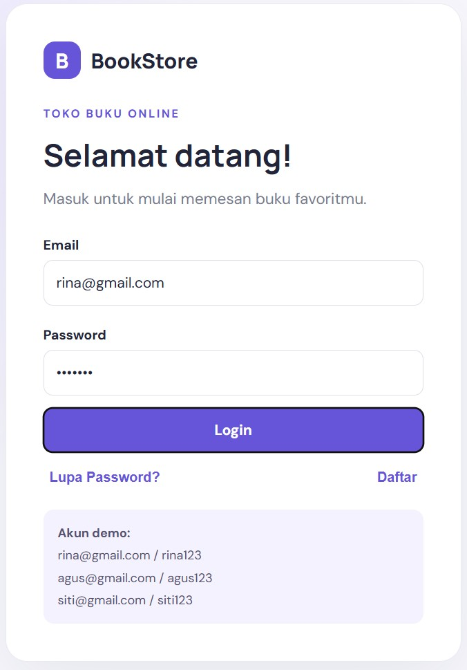
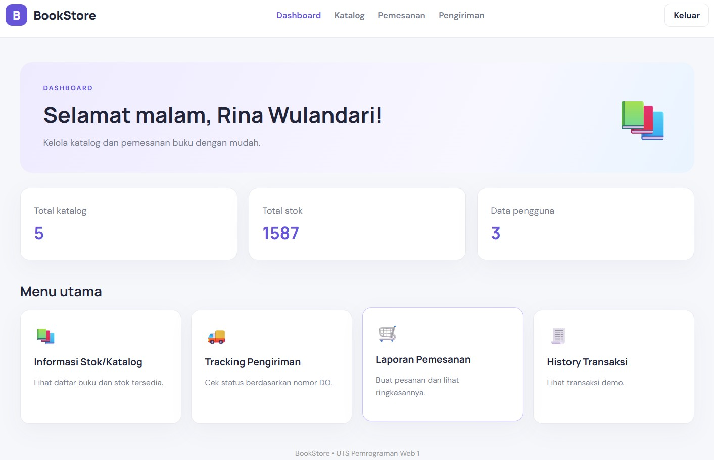
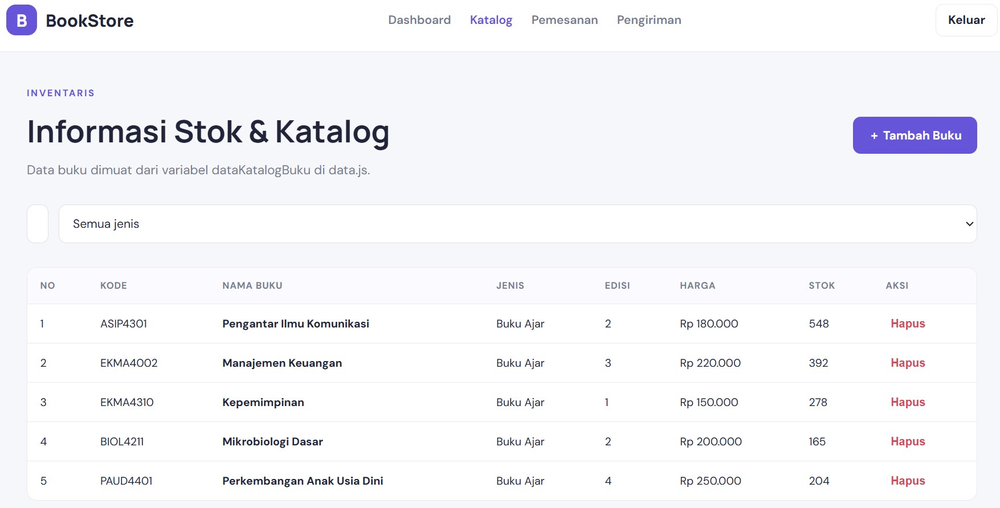
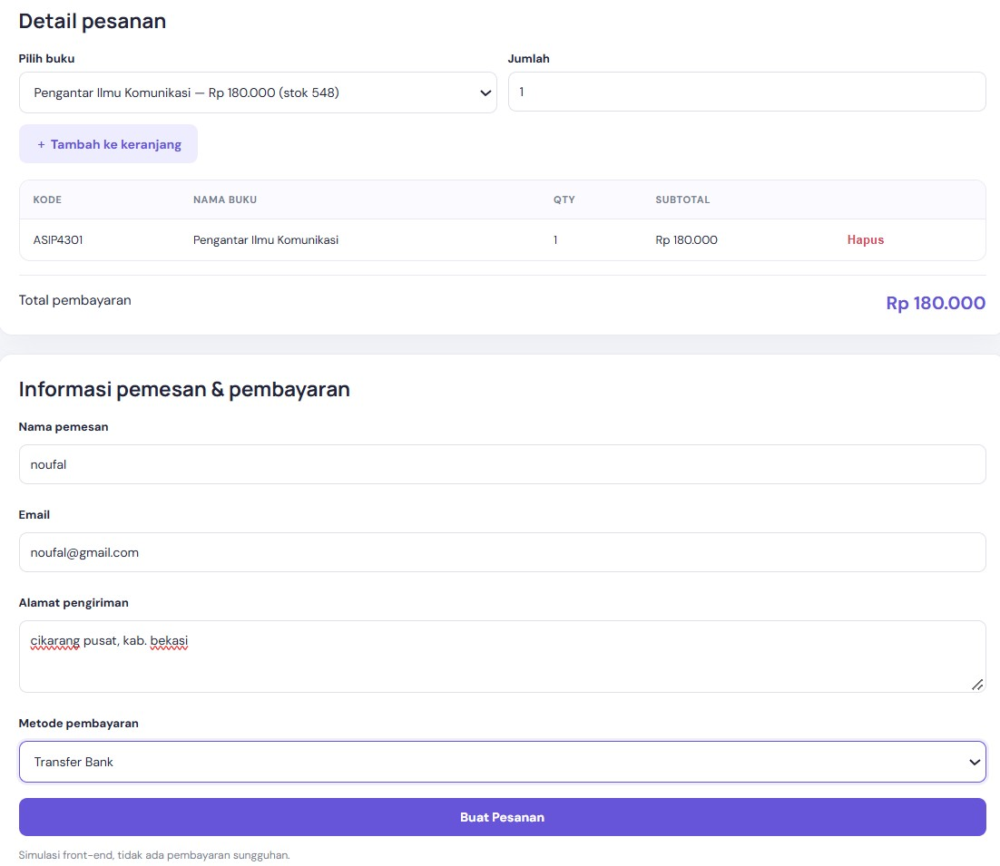
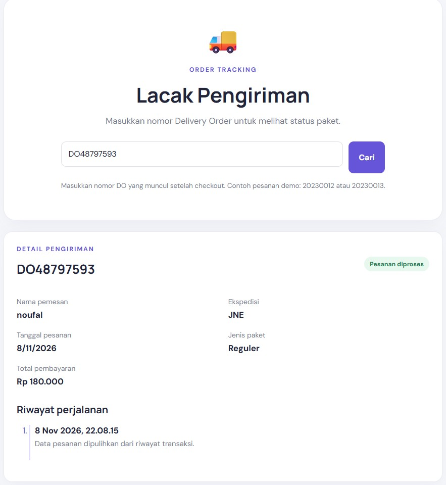

# BOOKSTORE – Aplikasi Pemesanan Buku Online

## 1. Informasi Project

**Nama Project:** BookStore – Aplikasi Pemesanan Buku Online  
**Mata Kuliah:** Pemrograman Web 1  
**Nama Mahasiswa:** Noufal Dwi Gustofa  
**NIM:** 312510004  
**Kelas:** I.25.3A  
**Program Studi:** Teknik Informatika  

## 2. Deskripsi Project

BookStore merupakan aplikasi pemesanan buku online berbasis website yang dibuat menggunakan HTML, CSS, dan JavaScript.

Aplikasi ini dirancang untuk memudahkan pengguna dalam melihat katalog buku, mencari buku, memilih buku, melakukan pemesanan, serta melihat informasi status pengiriman pesanan.

Project ini merupakan aplikasi frontend sehingga belum menggunakan server maupun database. Data pengguna, katalog buku, dan transaksi dikelola menggunakan JavaScript dan Local Storage pada browser.

## 3. Tujuan Pembuatan Project

1. Menerapkan penggunaan HTML untuk membuat struktur halaman website.
2. Menerapkan CSS untuk mengatur tampilan dan desain website.
3. Menerapkan JavaScript untuk membuat website menjadi interaktif.
4. Memahami penggunaan array dan object sebagai penyimpanan data.
5. Menerapkan validasi form login dan pemesanan.
6. Membuat aplikasi pemesanan buku online sederhana.

## 4. Teknologi yang Digunakan

- HTML5
- CSS3
- JavaScript
- Visual Studio Code
- Browser Google Chrome
- Live Server Extension
- Local Storage

## 5. Fitur Aplikasi

1. **Login:** Pengguna dapat masuk menggunakan email dan password.
2. **Dashboard:** Menampilkan halaman utama aplikasi.
3. **Stok Buku:** Menampilkan katalog dan informasi stok buku.
4. **Pencarian Buku:** Memudahkan pengguna mencari buku.
5. **Checkout:** Menampilkan proses pemesanan buku.
6. **Tracking Pesanan:** Menampilkan informasi status pengiriman.
7. **Penyimpanan Data:** Menggunakan Local Storage browser.

## 6. Akun Login Demo

| Role | Email | Password |
|---|---|---|
| User | rina@gmail.com | rina123 |
| User | agus@gmail.com | agus123 |
| Admin | siti@gmail.com | siti123 |

## 7. Struktur Folder Project

```text
BookStore_Project_UTS/
│
├── login.html
├── dashboard.html
├── stok.html
├── checkout.html
├── tracking.html
├── data.js
├── script.js
├── style.css
├── README.md
│
├── img/
│   ├── pengantar_komunikasi.jpg
│   ├── manajemen_keuangan.jpg
│   ├── kepemimpinan.jpg
│   ├── mikrobiologi.jpg
│   └── paud_perkembangan.jpg
│
└── screenshots/
    ├── login.png
    ├── dashboard.png
    ├── stok-buku.png
    ├── checkout.png
    └── tracking.png
```

## 8. Langkah-Langkah Pengerjaan Project

### Langkah 1 – Membuat Folder Project
Membuat folder dengan nama `BookStore_Project_UTS` untuk menyimpan seluruh file aplikasi.

### Langkah 2 – Membuat File HTML
Membuat beberapa halaman HTML, yaitu:
- login.html
- dashboard.html
- stok.html
- checkout.html
- tracking.html

Setiap halaman memiliki fungsi masing-masing dalam aplikasi BookStore.

### Langkah 3 – Membuat File CSS
Membuat file `style.css` untuk mengatur desain website, seperti warna, ukuran tulisan, tata letak, tombol, tabel, dan tampilan halaman.

### Langkah 4 – Membuat Data JavaScript
Membuat file `data.js` yang berisi data pengguna, katalog buku, stok buku, dan data tracking pesanan menggunakan array dan object.

### Langkah 5 – Membuat Fungsi JavaScript
Membuat file `script.js` untuk mengatur berbagai fungsi aplikasi, seperti:
- Proses login.
- Menampilkan katalog buku.
- Pencarian buku.
- Pengelolaan stok.
- Proses checkout.
- Penyimpanan transaksi.
- Pengecekan tracking pesanan.

### Langkah 6 – Menambahkan Gambar Buku
Menambahkan gambar sampul buku ke dalam folder `img` agar katalog buku memiliki tampilan yang lebih menarik dan mudah dikenali.

### Langkah 7 – Menjalankan Project
Membuka folder project menggunakan Visual Studio Code, kemudian menjalankan file `login.html` menggunakan ekstensi Live Server.

### Langkah 8 – Melakukan Pengujian
Melakukan pengujian terhadap setiap halaman dan fitur aplikasi untuk memastikan fungsi berjalan dengan baik.

### Langkah 9 – Mengambil Screenshot
Mengambil tangkapan layar setiap halaman aplikasi sebagai bukti hasil pengerjaan project.

### Langkah 10 – Mengunggah ke GitHub
Mengunggah seluruh folder project ke repository GitHub dan mengatur repository menjadi Public agar dapat diakses oleh dosen.

## 9. Cara Menjalankan Aplikasi

1. Download atau clone repository project BookStore.
2. Ekstrak folder project jika masih berbentuk ZIP.
3. Buka folder `BookStore_Project_UTS` menggunakan Visual Studio Code.
4. Pastikan seluruh file berada di dalam folder yang benar.
5. Install ekstensi Live Server jika belum tersedia.
6. Klik kanan pada file `login.html`.
7. Pilih **Open with Live Server**.
8. Website BookStore akan terbuka melalui browser.
9. Masukkan akun demo untuk mencoba aplikasi.

## 10. Dokumentasi Screenshot

Masukkan screenshot hasil pengerjaan ke dalam folder `screenshots`.

### A. Halaman Login
Menampilkan halaman login untuk masuk ke aplikasi BookStore.



### B. Halaman Dashboard
Menampilkan halaman utama setelah pengguna berhasil login.



### C. Halaman Stok Buku
Menampilkan daftar buku beserta informasi harga dan stok.



### D. Halaman Checkout
Menampilkan proses pemesanan dan informasi total pembayaran.



### E. Halaman Tracking
Menampilkan informasi status pengiriman pesanan.



## 11. Kesimpulan

Berdasarkan pengerjaan project ini, saya dapat memahami penerapan HTML, CSS, dan JavaScript dalam pembuatan aplikasi website sederhana. Saya juga mempelajari penggunaan array, object, DOM, validasi form, tabel data, serta Local Storage.

Dengan adanya aplikasi BookStore, pengguna dapat melihat katalog buku, melakukan pemesanan, dan memeriksa status pengiriman melalui sebuah website sederhana.

Project ini dibuat untuk memenuhi tugas Ujian Tengah Semester (UTS) mata kuliah Pemrograman Web 1.